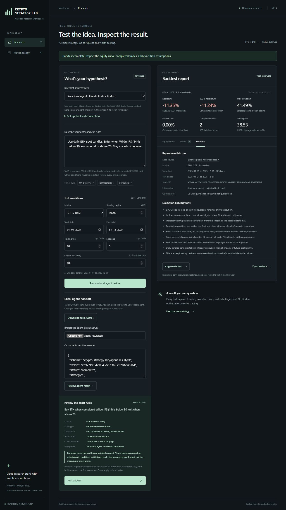

Crypto Strategy Lab is a browser workbench for reviewing and backtesting bounded BTC/ETH spot strategies.\
It demonstrates a control pattern relevant to agent payments: an agent proposes, a human reviews, then the app runs a historical backtest; payments are not implemented.\
Try the [live demo](https://crypto-strategy-lab.lilacclove129.chatgpt.site) or [run locally](#run-locally) with Node.js 22+.

# Crypto Strategy Lab

Describe a supported rule, inspect exactly what it means, run a historical test, and export a reproducible result.

[](https://crypto-strategy-lab.lilacclove129.chatgpt.site)

The screenshot shows the verified Codex handoff and reviewed ETH RSI backtest from 31 October 2026. It contains no API key field. This is historical research, not a profitability claim.

## Run locally

Requires Node.js 22 or newer:

```sh
git clone https://github.com/satwiksharma01/crypto-strategy-lab.git
cd crypto-strategy-lab
npm ci --ignore-scripts
npm start
```

Open [http://127.0.0.1:4321](http://127.0.0.1:4321). The server binds only to loopback. The free rule parser and browser backtest need no API key.

```sh
npm test
npm run build
```

`public/` is the static source. The build verifies assets, snapshot hashes, and real-data execution, then copies the site to `dist/`. The optional local MCP server uses the installed dependencies.

## Supported rules

The free interpreter is a bounded rule parser. It recognizes these forms, with editable assets, periods, and thresholds:

```text
Buy BTC when its 10-day moving average crosses above its 30-day moving average; sell on the reverse cross.
Buy ETH when RSI(14) is below 30; sell when RSI is above 70.
Buy and hold BTC.
```

Only BTC/ETH spot, long or cash, on fixed 2025 daily data. Extra conditions are rejected rather than silently ignored. RSI entries/exits use the completed RSI level below/above the reviewed thresholds; SMA entries/exits require actual crosses. There is no shorting, leverage, stop loss, user data feed, or live execution.

## Bring your own key or agent

Choose **Gemini · your API key** to interpret flexible descriptions into the same supported rule contract. The browser sends your prompt directly to Google's fixed HTTPS API using your key in a header. The key stays in the current tab, never local/session storage, share URLs, exports, or our server. Clear it when finished; browser scripts/extensions can access an entered key. Requests use your provider account and quota. The model is editable; the default is `gemini-3.5-flash-lite`.

One review click makes one bounded request with a 30-second timeout and no automatic retry. Unsupported or ambiguous strategies must reject; the app validates the returned rule object and still requires human review. Structured output cannot prove that a model preserved every requested condition. Neither the model nor an agent executes generated code.

For **Claude Code or Codex**, follow the [local MCP setup](docs/local-agent.md). Four stdio tools expose capabilities, validation, fixed-data backtests, and result preparation. The browser exports a versioned task JSON file and imports its matching result JSON. The agent proposes a supported strategy; the human reviews the exact rules and explicitly runs the browser backtest. Your agent uses its existing model account. There is no local HTTP listener, wallet connection, payment, or live order.

For a live development check, copy `.env.example` to the ignored `.env.local`, add your `GEMINI_API_KEY` there, then run:

```text
npm run check:gemini
```

This makes two real Gemini requests: a supported SMA rule and an unsupported stop-loss rejection. It prints no keys or raw responses. Never place a developer key in `public/` or deploy a shared demo key. Live Gemini interpretation and browser review/backtest were verified on 31 October 2026; mocked adapter tests remain a separate check.

Contract and API references: [agent result contract](docs/agent-contract.md), [Google structured output](https://ai.google.dev/gemini-api/docs/structured-output), [Gemini keys](https://ai.google.dev/gemini-api/docs/api-key).

## Agent verification

An authenticated **Codex CLI 0.164.0-alpha.11.1** session using its saved ChatGPT connection completed the task/result workflow on **31 October 2026**. The model name was unreported. Condensed transcript of the observed run:

```text
Task: Use daily ETH spot candles. Enter when Wilder RSI(14) is below 30;
      exit when it is above 70. Stay in cash otherwise.
MCP:  strategy_capabilities → validate_strategy → run_backtest → prepare_web_result
      All four calls completed, error=null; turn.completed, exit code 0.
Result: complete; {"type":"rsi","symbol":"ETHUSDT","period":14,"entry":30,"exit":70}; issues=[]
Browser QA: import actual result file → review thresholds/costs → explicit Run backtest.
Browser result: 8,865.08 USDT from 10,000; -11.35%; 2 completed trades.
```

The MCP backtest was preliminary research; the browser run followed explicit rule review. Separate automated MCP tests cover protocol integration without model authentication. Claude Code setup is documented and uses the same protocol; its authenticated run remains unverified because the attempted session hit a provider credit limit.

A user also reported the free-parser flow working on a physical phone; the exported BTC result matched an independent engine rerun. Handset and browser were unreported. See the [verification record](docs/mvp-verification.md) for the run settings, data hashes, and limits.

## Execution and metrics

Completed prior-bar signals execute at the next daily open. Commission and adverse slippage apply on both sides. Entries use a fixed share of available cash, including entry fees; no resizing occurs while held. The final position is sold at the last test close with costs, clearly marked as an end-of-period convention. Fractional fills do not model venue lot sizes, market impact, orderbook depth, or intraday paths.

Net return reconciles with equity and the trade ledger. Net win rate includes both commissions. Slippage is already embedded in execution prices. The buy-and-hold benchmark uses the same allocation, costs, and test dates. Indicator warmup can read preceding snapshot bars. The account starts flat; this release does not claim an unseen holdout, walk-forward validation, or future profitability.

## Historical data and provenance

Fixed 2025 BTCUSDT and ETHUSDT daily snapshots from [Binance Public Data](https://github.com/binance/binance-public-data). The fetch script verifies the provider's SHA-256 for each of 24 monthly ZIP archives. Each normalized JSON file has its own SHA-256 in `public/data/manifest.json`; the UI checks that identity before use.

Public availability and checksum identity are not independent price verification or an endorsement. Quotes and capital are in **USDT**, whose USD value can vary. This is historical research, not a live data feed or trading system.

The bundled `public/data/` snapshots are **excluded from MIT**. Binance supplies them under **CC BY-NC-SA 4.0** and its [Vision Dataset Terms](https://github.com/binance/binance-public-data/blob/master/TERMS_AND_CONDITIONS.md): attribution, noncommercial use, and share-alike obligations apply. See [data attribution and normalization notice](DATA_LICENSE.md). Commercial deployment needs appropriately licensed data; the software license does not grant that permission.

Regenerate the same fixed year (network required):

```text
python scripts/fetch-market-data.py
```

## Reports and sharing

Run results stay in your browser. JSON exports carry strategy, assumptions, data identity, and computed results. Remix links carry inputs only and require a new review and run; they are not permanently stored public performance reports. Export hashes identify bytes, not third-party certification of the model or data.

## Project boundaries and license

The MVP includes a free rule parser, Gemini BYOK interpretation, and local MCP task/result handoff around three supported strategy types. Accounts, durable report hosting, agent payments, paid tiers, leverage, and live execution are not implemented. Your provider bills any connected model use; this app does not enforce an account-wide provider budget.

Original software is available under the [MIT License](LICENSE), copyright 2026 Satwik Sharma. The engine is original spot code; no Vibe-Trading implementation was copied or relabeled. Upstream research informed next-bar/accounting checks and reporting requirements. Preserve source attribution and any applicable licenses if incorporating upstream code later. Bundled market data is separately licensed as described in [DATA_LICENSE.md](DATA_LICENSE.md).
